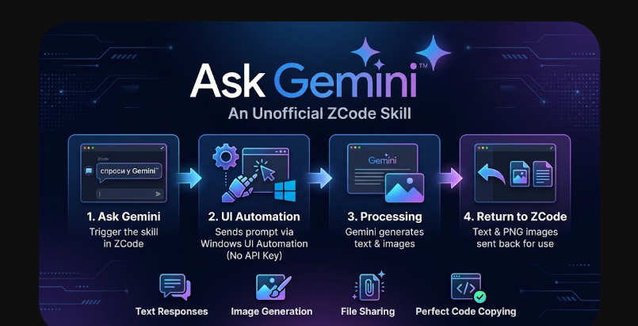

<div align="center">



# Ask Gemini™ — ZCode Skill

[](#requirements)
[](#key-features)
[](#key-features)
[](#license)
[](#ask-gemini--zcode-skill)

**🇷🇺 [Русская версия](#-спроси-gemini-на-русском) | 🇬🇧 [English Version](#english-version)**

</div>

---

## English Version

**`ask-gemini`** (`GeminiApp-Skill`) is a non-commercial, unofficial skill for **ZCode** on Windows. It bridges ZCode directly with the local **Google Gemini desktop application** via Windows UI Automation (UIA) — leveraging your existing Google account and subscription without API keys, third-party proxies, or external relays.

### Key Features

- 🔒 **Zero API Keys & 100% Direct** — Interacts directly with your locally installed Google Gemini desktop client (`Gemini.exe`). No cloud middleman; data stays strictly between your machine and Google Gemini.
- 💬 **Seamless Text Responses** — Sends prompts and returns formatted responses directly back into ZCode.
- 💻 **Lossless Code Extraction** — Reliably extracts large code blocks via Gemini's native `"Copy code"` button without truncation or markdown corruption.
- 🖼️ **Image Generation Capture** — Automatically captures generated images from the Gemini window and saves them directly as `.png` files.
- 📎 **File Attachments Support** — Passes local files to Gemini using clipboard `CF_HDROP` + `Ctrl+V` automation.
- 🚀 **Auto-Launch & Clean Context** — Automatically starts the Gemini app if it isn't running and initiates a fresh chat session for every request.

### Requirements

- **OS:** Windows 10 or Windows 11
- **Google Gemini Desktop App:** Installed at `%LOCALAPPDATA%\Google\Gemini\Gemini.exe` and logged into an active Google account
- **Host Environment:** ZCode (or PowerShell 5.1+ for standalone CLI execution)

### Installation

Copy the repository contents into your local ZCode skills directory:

**Target Directory:**
```text
%USERPROFILE%\.agents\skills\ask-gemini\
```

**Expected File Structure:**
```text
%USERPROFILE%\.agents\skills\ask-gemini\
├── SKILL.md
├── assets\
│   └── banner.png
└── scripts\
    └── gemini_ask.ps1
```

**Quick Install via PowerShell:**
```powershell
git clone https://github.com/YOUR_USERNAME/GeminiApp-Skill.git "$env:USERPROFILE\.agents\skills\ask-gemini"
```

### Usage

#### 1. Inside ZCode (Natural Language Triggers)
Invoke the skill in ZCode using natural phrasing in English or Russian (including common transliterations or typos of "Gemini"):

- `"ask Gemini ..."`
- `"спроси у Gemini ..."`
- `"спроси Gemini ..."`
- `"попроси Джимини ..."`
- `"уточни у Gemini ..."`

#### 2. Standalone CLI Execution
You can execute the automation script directly from PowerShell:

**Basic Text Query:**
```powershell
powershell -NoProfile -ExecutionPolicy Bypass -File scripts\gemini_ask.ps1 -Question "Explain async/await in C# with a brief example"
```

**Query from a UTF-8 File with a File Attachment:**
```powershell
powershell -NoProfile -ExecutionPolicy Bypass -File scripts\gemini_ask.ps1 -QuestionFile "prompt.txt" -FilePath "C:\path\to\script.py" -MaxWaitSec 300
```

**Image Generation Request:**
```powershell
powershell -NoProfile -ExecutionPolicy Bypass -File scripts\gemini_ask.ps1 -Question "Generate a cyberpunk terminal icon" -ImageOut "C:\output\icon.png"
```

### Script Parameters

| Parameter | Type | Default | Description |
| :--- | :--- | :--- | :--- |
| `-Question` | `string` | — | Direct text prompt to send to Gemini. |
| `-QuestionFile` | `string` | — | Path to a UTF-8 encoded text file containing the prompt. |
| `-MaxWaitSec` | `int` | `240` | Maximum time (in seconds) to wait for Gemini to finish generating a response. |
| `-ImageOut` | `string` | — | Output file path (`.png`) to capture and save a generated image. |
| `-FilePath` | `string` | — | Path to a local file to attach to the prompt (injected via `CF_HDROP` + `Ctrl+V`). |

### Exit Codes

| Code | Meaning |
| :---: | :--- |
| `0` | **Success** — Response received and processed. |
| `2` | **App Launch Failed** — Google Gemini application could not be started. |
| `3` | **Input Field Not Found** — UIA could not locate the prompt text box. |
| `4` | **Send Button Not Found** — UIA could not locate the submit button. |
| `5` | **Timeout / No Response** — No answer received within `-MaxWaitSec`. |
| `6` | **Send Failed** — The question could not be submitted to the chat. |
| `7` | **Missing Prompt** — Neither `-Question` nor `-QuestionFile` was provided (or prompt is empty). |
| `8` | **Attachment Not Found** — The file specified in `-FilePath` does not exist. |
| `9` | **Attachment Rejected** — The Gemini app failed to accept the pasted file attachment. |

### Troubleshooting

- **Exit Codes `3` or `4` (UIA Element Not Found):**
  Google Gemini updates may occasionally rename or restructure internal UI Automation elements. To fix this, inspect the updated window tree (e.g., using *Inspect.exe* or *Accessibility Insights*) and update the target element regular expressions inside `scripts\gemini_ask.ps1`.
- **Exit Code `2` (App Launch Failed):**
  Verify that Google Gemini is installed at `%LOCALAPPDATA%\Google\Gemini\Gemini.exe` and that you are signed into your account.
- **Exit Code `9` (Attachment Rejected):**
  Ensure the desktop window is not blocked by a modal dialog and the file format is supported by Gemini.

### License

Distributed under the **MIT License**. Note: *Ask Gemini™* and *Google Gemini* are trademarks of their respective owners. This project is an independent, unofficial tool and is not affiliated with or endorsed by Google LLC.

---

## 🇷🇺 Спроси Gemini (на русском)

**`ask-gemini`** (`GeminiApp-Skill`) — некоммерческий неофициальный скилл для **ZCode** под Windows. Отправляет запросы напрямую в **локальное десктопное приложение Google Gemini** через Windows UI Automation (UIA), используя ваш текущий аккаунт и подписку. Никаких API-ключей, никаких сторонних прокси-сервисов — данные не покидают компьютер никуда, кроме самого приложения Gemini.

### Ключевые возможности

- 🔒 **Без API-ключей и посредников** — Работает напрямую с локальным клиентом Google Gemini для Windows (`Gemini.exe`) под вашей учётной записью.
- 💬 **Текстовые ответы в ZCode** — Отправляет промпты и возвращает готовые текстовые ответы обратно в рабочее пространство ZCode.
- 💻 **Точное копирование кода** — Надёжно извлекает большие блоки кода через штатную кнопку `"Copy code"` без обрезаний и искажений разметки.
- 🖼️ **Захват генерации изображений** — Автоматически перехватывает сгенерированные нейросетью картинки и сохраняет их в формате `.png`.
- 📎 **Передача файлов-вложений** — Прикрепляет локальные файлы к запросу через буфер обмена (`CF_HDROP` + эмуляция `Ctrl+V`).
- 🚀 **Автозапуск и чистый контекст** — Скрипт сам запускает приложение Gemini при необходимости; каждый запрос выполняется в новом чате.

### Требования

- **ОС:** Windows 10 / Windows 11
- **Приложение Google Gemini:** Установленное по пути `%LOCALAPPDATA%\Google\Gemini\Gemini.exe` с выполненным входом в аккаунт
- **Среда:** ZCode (или PowerShell 5.1+ для прямого запуска из консоли)

### Установка

Скопируйте содержимое репозитория в каталог скиллов ZCode:

**Целевая папка:**
```text
%USERPROFILE%\.agents\skills\ask-gemini\
```

**Структура файлов:**
```text
%USERPROFILE%\.agents\skills\ask-gemini\
├── SKILL.md
├── assets\
│   └── banner.png
└── scripts\
    └── gemini_ask.ps1
```

**Быстрая установка через PowerShell:**
```powershell
git clone https://github.com/YOUR_USERNAME/GeminiApp-Skill.git "$env:USERPROFILE\.agents\skills\ask-gemini"
```

### Использование

#### 1. Вызов в ZCode (Natural-Language триггеры)
Скилл активируется естественными фразами на русском и английском языках (включая любые опечатки и транслитерации имени Gemini):

- `"спроси у Gemini ..."`
- `"спроси Gemini ..."`
- `"попроси Джимини ..."`
- `"уточни у Gemini ..."`
- `"ask Gemini ..."`

#### 2. Прямой запуск скрипта (PowerShell)
Скрипт автоматизации можно вызывать напрямую из командной строки без ZCode:

**Обычный текстовый запрос:**
```powershell
powershell -NoProfile -ExecutionPolicy Bypass -File scripts\gemini_ask.ps1 -Question "Объясни разницу между IEnumerable и IQueryable в C#"
```

**Запрос из UTF-8 файла с прикреплением вложения:**
```powershell
powershell -NoProfile -ExecutionPolicy Bypass -File scripts\gemini_ask.ps1 -QuestionFile "prompt.txt" -FilePath "C:\path\to\module.py" -MaxWaitSec 300
```

**Генерация изображения с сохранением в PNG:**
```powershell
powershell -NoProfile -ExecutionPolicy Bypass -File scripts\gemini_ask.ps1 -Question "Нарисуй минималистичный логотип терминала в стиле киберпанк" -ImageOut "C:\output\logo.png"
```

### Параметры скрипта

| Параметр | Тип | По умолчанию | Описание |
| :--- | :--- | :--- | :--- |
| `-Question` | `string` | — | Текст вопроса (промпта) для отправки в Gemini. |
| `-QuestionFile` | `string` | — | Путь к текстовому файлу в кодировке UTF-8 с текстом запроса. |
| `-MaxWaitSec` | `int` | `240` | Максимальное время ожидания ответа в секундах. |
| `-ImageOut` | `string` | — | Путь для сохранения `.png` файла при генерации изображения. |
| `-FilePath` | `string` | — | Путь к файлу-вложению для отправки в чат (через `CF_HDROP` + `Ctrl+V`). |

### Коды выхода

| Код | Описание |
| :---: | :--- |
| `0` | **Успех** — Ответ успешно получен и обработан. |
| `2` | **Приложение не запустилось** — Не удалось запустить `Gemini.exe`. |
| `3` | **Нет поля ввода** — UIA не обнаружил текстовое поле для ввода промпта. |
| `4` | **Нет кнопки отправки** — UIA не обнаружил кнопку отправки сообщения. |
| `5` | **Нет ответа / Таймаут** — Время ожидания превысило `-MaxWaitSec`. |
| `6` | **Вопрос не отправлен** — Сбой при передаче текста в окно чата. |
| `7` | **Нет вопроса** — Не указан `-Question` или `-QuestionFile` (либо вопрос пуст). |
| `8` | **Файл-вложение не найден** — Указанный в `-FilePath` файл не существует. |
| `9` | **Вложение не принято** — Приложение Gemini не приняло вставленный из буфера файл. |

### Устранение неполадок (Troubleshooting)

- **Коды выхода `3` или `4` (не найдено поле ввода или кнопка отправки):**
  Означают, что очередное обновление клиента Google Gemini переименовало внутренние UIA-элементы интерфейса. Для исправления откройте `scripts\gemini_ask.ps1` и обновите регулярные выражения поиска элементов в соответствии с новой разметкой окна.
- **Код выхода `2` (приложение не запустилось):**
  Убедитесь, что десктопный клиент установлен по пути `%LOCALAPPDATA%\Google\Gemini\Gemini.exe` и в нём выполнена авторизация.
- **Код выхода `9` (приложение не приняло вложение):**
  Проверьте, не перекрыто ли окно Gemini модальным диалогом и поддерживается ли тип передаваемого файла.

### Лицензия

Проект распространяется под лицензией **MIT**. *Ask Gemini™* и *Google Gemini* являются товарными знаками соответствующих правообладателей. Данный репозиторий является независимой неофициальной разработкой и не связан с корпорацией Google LLC.
